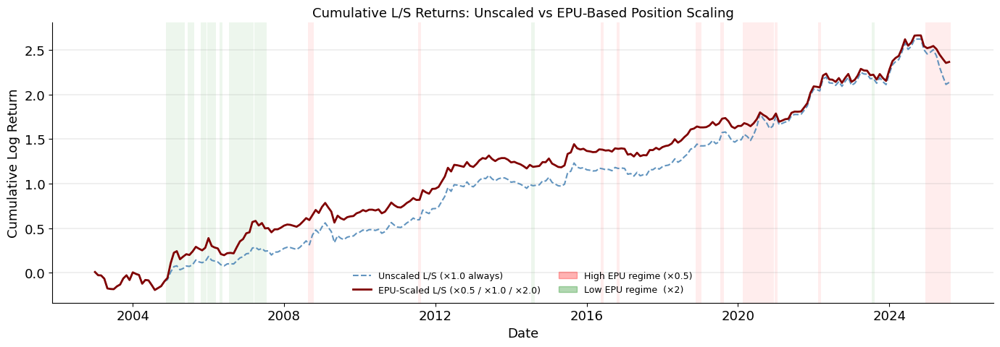
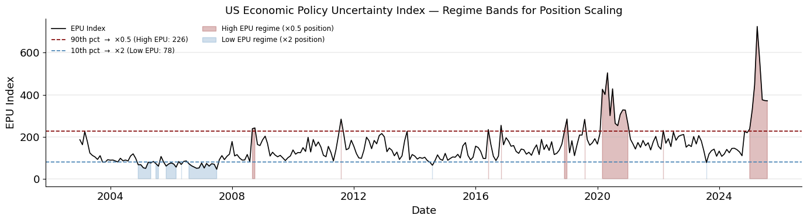

# Multi-Factor Alpha & Dynamic Position Sizing in U.S. Equities

A market-neutral long-short U.S. equity strategy that combines six academic alpha signals, re-weights them with a walk-forward machine-learning model, and scales gross exposure with the **Economic Policy Uncertainty (EPU)** index.

*Independent research with Prof. Ralph Koijen, University of Chicago Booth School of Business (Winter 2026), completed in Quantitative Portfolio Management.*

<p align="center">
  
</p>

## Headline results (Jan 2003 – Aug 2025, 272 months)

| Metric | Unscaled L/S | **EPU-scaled L/S** |
|---|---:|---:|
| Annualized return | 10.71% | **11.70%** |
| Annualized volatility | 15.99% | **15.77%** |
| Sharpe ratio | 0.670 | **0.741** |
| Maximum drawdown | −48.1% | **−29.7%** |
| Six-factor alpha (FF5 + UMD), annualized | 9.04% (t = 2.99) | **9.78% (t = 3.21)** |
| Information ratio | 0.664 | **0.712** |
| Market beta | ≈ 0 | ≈ 0 |

Out-of-sample check (weights fit on 2003–2013, evaluated on 2014–2025):

| Signal combination | In-sample Sharpe | Out-of-sample Sharpe |
|---|---:|---:|
| A: Max-Sharpe optimizer (static weights) | 0.491 | 0.289 |
| B: Ridge walk-forward (re-fit monthly) | 1.281 | 0.460 |
| **50/50 blend of A and B** | 0.807 | **0.534** |

## How it works

**1. Universe.** CRSP/Compustat merged panel of U.S. common stocks (share codes 10/11) on NYSE, AMEX and NASDAQ: 11,243 securities and 1.13M firm-months. Stocks need 12 consecutive months of history to enter.

**2. Six signals.** Each is lagged one month, z-scored cross-sectionally every month and winsorized at ±3σ.

| # | Signal | Construction | Reference |
|---|---|---|---|
| S1 | Intermediate momentum | Cumulative return from t−12 to t−7 | Jegadeesh & Titman (1993) |
| S2 | Gross profitability | (Revenue − COGS) / Total assets | Novy-Marx (2013) |
| S3 | Profitability improvement | 0.6 · z(level) + 0.4 · z(YoY change) | Chordia & Shivakumar (2006) |
| S4 | Asset growth (negated) | −(Assets / Assets₋₁₂ − 1) | Cooper, Gulen & Schill (2008) |
| S5 | Volume percentile | Volume vs. the stock's own 12-month history (negated) | Hou & Moskowitz (2005) |
| S6 | Fear-scaled momentum | Momentum dampened when trading volume spikes | Daniel & Moskowitz (2016) |

**3. Signal combination.**
- **Method A, Max-Sharpe optimizer:** long-only signal weights that maximize the in-sample Sharpe ratio with an L2 penalty, fit on 2003–2013 only and then frozen.
- **Method B, Ridge walk-forward:** each month, a Ridge regression of next-month returns on the six signals is fit on the prior 60 months, so every prediction is out-of-sample by construction.

**4. Portfolio.** Each month, stocks are sorted into deciles on the combined signal. The portfolio goes long the top decile and short the bottom decile, value-weighted by lagged market cap and rebalanced monthly.

**5. EPU overlay.** Gross exposure is halved (×0.5) in months when the [Baker–Bloom–Davis EPU index](https://www.policyuncertainty.com/) is above its 90th percentile and doubled (×2.0) below its 10th percentile. The overlay leaves stock selection unchanged and only scales the size of the book.

<p align="center">
  
</p>

## Repository layout

```
├── notebooks/QPM_Final_Project.ipynb   # full pipeline with outputs: data → signals → combination → portfolio → EPU → analytics
├── paper/QPM_Final_Project_Paper.pdf   # 18-page write-up with literature, method and all tables
├── figures/                            # every chart the notebook produces
├── data/README.md                      # input files the notebook expects (not redistributed)
└── requirements.txt
```

## Reproducing

```bash
pip install -r requirements.txt
# place the input files described in data/README.md next to the notebook
jupyter notebook notebooks/QPM_Final_Project.ipynb
```

The CRSP/Compustat panel is licensed through WRDS and is **not included**. The notebook is committed with its outputs, so every table and chart can be read on GitHub without running it.

## Limitations

These are stated in the paper and worth knowing before reading the numbers:

- **No transaction costs.** Momentum and volume signals turn over heavily, so net returns will be lower.
- **EPU thresholds use full-sample percentiles,** which is a mild look-ahead. An expanding-window percentile would be the live-trading version.
- **The ×2.0 low-EPU scaling adds leverage.** Part of the return gain comes from running more gross exposure in calm months, not only from avoiding bad ones.
- **The decile spread is not monotonic.** D10 earns the most (1.41%/month) and D1 the least (0.52%), but D2–D9 are roughly flat.

## Tools

Python · pandas · NumPy · SciPy (SLSQP optimization) · scikit-learn (Ridge) · statsmodels (factor regressions) · matplotlib
